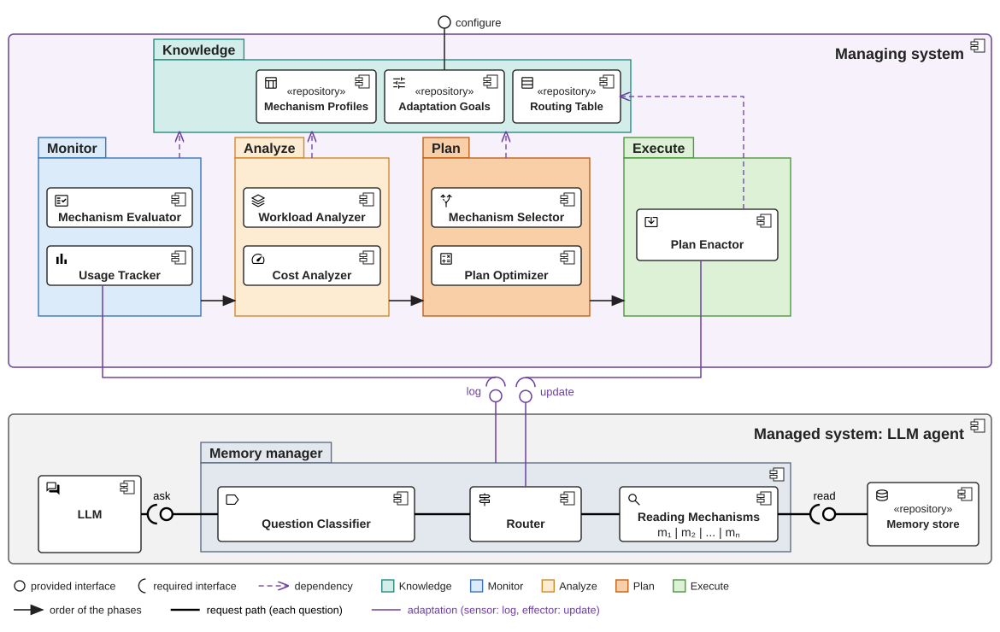

<div align="center">

# MemSwap: Architecting Self-Adaptive Memory for AI Agents

**Replication package**

Sreemaee Akshathala · Karthik Vaidhyanathan

Software Engineering Research Center (SERC), IIIT Hyderabad, India

<!-- Badges: add once available
[](https://arxiv.org/abs/XXXX.XXXXX)
[](https://doi.org/10.5281/zenodo.XXXXXXX)
-->
[](#license)
[](DATA_LICENSES.md)
[](#reproducing-the-results)

</div>

---

This repository rebuilds every table and number of the paper from the logged outcomes of the experiments, without
model calls and without an API key. Every mechanism answered every question once, two LLM judges scored every answer,
and the package replays the architecture over these outcomes, so the whole reproduction is deterministic and takes
about 2 minutes.

<p align="center">
  
</p>
<p align="center"><em>The MemSwap architecture. The managed system is the LLM agent, whose memory manager holds the
Question Classifier, the Router and the reading mechanisms. The managing system is a MAPE-K loop that runs off the
request path; <code>log</code> is its sensor and <code>update</code> its effector.</em></p>

## Abstract

LLM agents increasingly rely on memory to recall earlier interactions when they answer new queries. How an agent reads
this memory determines both the accuracy of its answers and the tokens it spends. However, these agents operate under
runtime uncertainties, such as unpredictable tasks and fluctuating token budgets, and no single way of reading memory
suits every type of question. Existing memory systems fix how they read memory at design time, and therefore either
overspend on questions that a cheap lookup could answer, or fail those that need a deeper search. To address this, we
introduce MemSwap, a self-adaptive approach that enables runtime selection of memory reading mechanisms in LLM agents
using a MAPE-K loop. MemSwap allows system architects to define an accuracy margin and a token budget, and performs
runtime monitoring of the types of arriving questions and of the accuracy and cost of each mechanism, to plan which
mechanism each question type should use. We evaluate the effectiveness and efficiency of MemSwap on two standard long-
conversation benchmarks, LoCoMo and LongMemEval, against two established memory systems, Mem0 and Letta, and five
fixed memory mechanisms. Our results show that MemSwap is on par with, or more accurate than every baseline, while
using 7% to 24% fewer tokens than Mem0 and 74% to 83% fewer tokens than Letta. Under most token budgets on LoCoMo, it
is 2.6 to 8.7 points more accurate than the best fixed mechanism that fits, and it maintains its accuracy when the
workload shifts, with under 10 ms of overhead per answer. These results point to self-adaptation as a promising
approach for managing memory in agentic AI systems.

**Index Terms:** software architecture, self-adaptive systems, MAPE-K, LLM agents, agent memory, runtime adaptation

## Research Questions

| | Question |
|---|---|
| **RQ1** | With MemSwap, does the agent maintain the accuracy of its most accurate reading mechanism at a lower token cost? |
| **RQ2** | When the token budget or the workload changes at runtime, does MemSwap adapt how the agent reads its memory better than fixed mechanisms and budget-matched mixing? |
| **RQ3** | What overhead does MemSwap add, on the request path and off it, in tokens and time, and do its token savings exceed the tokens spent on profiling? |

## Results at a Glance

"Matches" means that neither judge finds MemSwap significantly less accurate (exact McNemar test, p < 0.05).

| RQ | Result | Where in this package |
|---|---|---|
| RQ1 | Matches fixed iterative search, the most accurate fixed mechanism, with 21–34% fewer memory tokens on all three datasets | `results/tables/`, `results/replay.json` |
| RQ1 | Matches Mem0 with 7–24% fewer tokens and Letta with 74–83% fewer | `results/replay.json`, `results/letta_empty_answers.json` |
| RQ2 | 2.6 to 8.7 points more accurate than the best fixed mechanism that fits, at four of six token budgets on LoCoMo | `results/replay.json` (budgets) |
| RQ2 | Keeps its accuracy when the workload shifts, while a fixed single lookup falls from 77% to 61% | `results/replay.json` (streams), `results/predicted_question_types.json` |
| RQ3 | Under 10 ms and no tokens per question on the request path; profiling is repaid after 756 to 7,541 served questions | `results/expected/logged/` |

## Using MemSwap

There are three ways to use this package, from checking the paper to running MemSwap in front of your own agent.

### 1. Reproduce the paper (no model, no API key)

```bash
python reproduce.py            # every table and number of the paper, PASS / FAIL per number, about 2 minutes
```

See [Reproducing the Results](#reproducing-the-results) for the other checks.

### 2. Replay MemSwap on your own logged outcomes (no model, no API key)

If you have run your own reading mechanisms on your own questions, MemSwap can choose between them by replay, exactly
as in the paper. In short:

1. Add one row per question and mechanism to `data/answers.csv`, with the question type, the judge's verdict (1 or 0)
   and the memory tokens. The columns are described in [`data/README.md`](data/README.md).
2. Register a new dataset in `evaluation.py`, or a new mechanism in `memswap/knowledge/knowledge_base.py`.
3. Update `data/SHA256SUMS`, then run `python reproduce.py`. The paper's numbers now FAIL wherever your data changes a
   decision, which is expected. The new results are in `results/replay.json` and `results/tables/`.

[`docs/EXTEND.md`](docs/EXTEND.md) gives each step in detail. It covers adding a reading mechanism (section 1) or a
dataset (section 2), and swapping the selection rule (section 3) or the planner (section 4).

### 3. Put MemSwap in front of a live agent

The managed system is your agent. It provides one function per reading mechanism, which answers a question and
returns the memory tokens it spent, and a judge, which scores an answer on labelled questions. `memswap/live.py`
profiles the mechanisms on a labelled batch, writes the Routing Table, and answers every later question with the
mechanism of its question type:

```python
from memswap.knowledge.knowledge_base import AdaptationGoals
from memswap.live import LiveMemSwap, Question

mechanisms = {"single_lookup": my_lookup,          # each: question -> (answer, memory tokens)
              "planned_read": my_planned_read,
              "iterative_search": my_search}
live = LiveMemSwap(mechanisms, judge=my_judge,     # judge: (question, answer) -> 1 or 0
                   classify=my_question_classifier,  # question -> question type
                   goals=AdaptationGoals(margin=0.01))
live.labelled_batch(labelled_questions)           # Questions with a question type and a gold answer
record = live.ask(Question("q1", "When did I place my last order?"))
print(record["mechanism"], record["outcome"], record["tokens"])
live.set_budget(3168)                             # a new token budget: the loop re-plans
```

This wiring is tested twice:
- **Without a model.** `python live/example_mock.py` runs it with mock mechanisms and a mock judge, and `pytest` runs
  the same example (`tests/test_live_wiring.py`).
- **With the real mechanisms and model.** `python live/smoke_test.py` runs it with the paper's three mechanisms and
  DeepSeek V4.1 Flash on five LoCoMo questions. Our run is recorded in
  [`live/smoke_test_result.json`](live/smoke_test_result.json); see [`live/README.md`](live/README.md).

The live wiring profiles labelled batches. The paper's configuration does not profile at runtime (profiling cap 0),
and `LiveMemSwap` follows it. To add a mechanism beyond the three, see `docs/EXTEND.md`, section 1.

## Methodology

1. **Datasets.** LoCoMo (1,534 questions, ten conversations), LongMemEval-S* (299 questions, five conversations) and
   LongMemEval-R (200 questions, three conversations), with the question types of each benchmark.
2. **Logged outcomes.** The three reading mechanisms answered every question with DeepSeek V4.1 Flash at temperature 0;
   iterative search without context pruning, Mem0 and Letta were run on LoCoMo and LongMemEval-S*. Two LLM judges,
   DeepSeek V4.1 Flash and gpt-oss-120b, scored the answers with the same prompt; the answers to the LongMemEval-S* questions with no answer in memory are
   labelled by hand against one rule (`data/README.md`). Token counts are the input tokens reported by the model endpoint.
3. **Replay.** MemSwap runs over these outcomes with leave-one-conversation-out folds, an accuracy margin of one point
   and a profiling cap of zero, under six token budgets per dataset, a budget drop, and five workload streams.
4. **Statistics.** Paired comparisons use the exact McNemar test; the selection rule uses a one-sided 95% Wilson lower
   bound. `stats/verify_stats.py` recomputes the statistics independently of our code.

## Repository Structure

```
memswap_replication_public/
├── reproduce.py                  ★ One command: rebuilds every result and checks every number of the paper
├── replay.py                     The experiment protocols: folds, budgets, drop scenario, streams
├── evaluation.py                 Data loading, baselines and statistics
├── paper_numbers.py              Maps each number of the paper to its key in the result files
├── memswap/                      The architecture, one module per component of Fig. 1
│   ├── knowledge/                Mechanism Profiles, Adaptation Goals, Routing Table
│   ├── monitor/                  Usage Tracker, Mechanism Evaluator
│   ├── analyze/                  Workload Analyzer, Cost Analyzer
│   ├── plan/                     Mechanism Selector, Plan Optimizer
│   ├── execute/                  Plan Enactor
│   ├── managed/                  Memory manager (Question Classifier, Router, reading mechanisms), memory store
│   ├── loop.py                   The MAPE-K loop in the order of Algorithm 1
│   └── live.py                   Wiring for a live agent: its mechanisms and judge, profiled and routed by the loop
├── checks/                       Letta without its empty answers, streams with predicted question types, timings
├── stats/verify_stats.py         Independent recomputation of the statistics
├── data/                         Logged answers, verdicts, tokens, streams and folds (see data/README.md)
├── results/
│   ├── paper_numbers.csv         Every number of the paper with its source key
│   └── expected/                 The result files behind the paper, and the logged timings
├── notebooks/memswap_demo.ipynb  The paper's running example end to end
├── live/                         Model-facing code: the mock and real live examples, and the code that produced data/
├── docs/EXTEND.md                How to add a mechanism, a dataset, a selection rule or a planner
├── tests/                        pytest
└── figures/architecture.svg      The architecture figure
```

## Reproducing the Results

```bash
python3.12 -m venv .venv && . .venv/bin/activate
pip install -r requirements.txt
```

| Step | Command | Output | Time |
|---|---|---|---|
| All results, every number checked | `python reproduce.py` | `results/report.md`, `results/*.json`, `results/tables/` | about 2 min |
| Faster run, without the predicted-type streams | `python reproduce.py --fast` | as above | about 1.5 min |
| Statistics, independently of our code | `python stats/verify_stats.py` | `results/stats_verification.csv` | about 3 s |
| Unit tests and data checks | `pytest` | | about 2 s |
| The running example | `jupyter nbconvert --to notebook --execute notebooks/memswap_demo.ipynb --output executed.ipynb` | `notebooks/executed.ipynb` | about 15 s |
| Component timings on your machine (optional) | `python checks/time_components.py` | `results/time_components.json` | a few minutes |

Python 3.12 on Linux, tested with the pinned versions in `requirements.txt`. All random draws use fixed seeds
(`numpy.random.default_rng(0)`, `random_state=0`).

## Paper Components and Modules

Each component of the architecture figure has its own module; the map is in [`memswap/README.md`](memswap/README.md).

## Outputs of `reproduce.py`

| file | content |
|---|---|
| `results/report.md` | the verdict, and one line per number: PASS, FAIL or LOGGED, paper value, recomputed value, source key |
| `results/replay.json` | all experiments: per system and per question type (Tables I, II), budgets and the drop scenario (Table III), workload streams (Table IV), predicted question types |
| `results/letta_empty_answers.json` | MemSwap against Letta with and without Letta's empty answers |
| `results/predicted_question_types.json` | the streams with predicted question types |
| `results/decisions.csv` | which mechanism served each question in each experiment |
| `results/tables/` | Tables I to IV as CSV, with unrounded values |

A run passes when (a) every number of the paper equals its recomputed value as printed, (b) every value of the three
recomputed JSON files equals the one in `results/expected/`, and (c) `decisions.csv` equals the expected one.
463 numbers of the paper are checked: 444 are recomputed and 19 are LOGGED. The LOGGED ones are the timings and
judge-token counts of RQ3. They were measured once on our machine (AMD Ryzen 5 9600X) and from our run logs, so they
are read from `results/expected/logged/` and cannot be recomputed from `data/`. Three arithmetic checks tie them to
the recomputed results (token savings, payback, profiling tokens).

Key names that start with memswitch refer to MemSwap. `paper_numbers.py` maps every number to its key.

## Verifying the statistics

`stats/verify_stats.py` does not import `memswap`, `evaluation.py` or `replay.py`. From `data/answers.csv` and its own
implementations it recomputes
- the selection rule and its decisions for the main experiment (leave-one-conversation-out, both judges),
- every Wilson lower bound behind Table I's selection,
- every exact McNemar p value and accuracy difference of a comparison between systems (Table II, the budgets, the
  drop scenario, the streams, predicted against labelled question types, Letta without its empty answers),
- Cohen's kappa between the two judges.

It prints one line per value (ours, independent, match) and writes `results/stats_verification.csv`. For the
experiments other than the main one it takes from our pipeline only which mechanism served each question
(`results/decisions.csv`). Comparisons that average 200 random draws (random selection, budget-matched mixing) are
not recomputed there; `reproduce.py` recomputes them with the fixed seed.
It checks all 248 values only after a full `python reproduce.py` run; after `--fast` it checks 234, because
`--fast` does not write the decisions of the streams with predicted question types.

## Data

`data/answers.csv` has one row per question and system (11,598 rows; 2,033 questions): the verdict of the primary
judge (DeepSeek V4.1 Flash) and of the second judge (gpt-oss-120b), the memory tokens as reported by the model
endpoint, and the steps of iterative search. Systems: the three reading mechanisms, iterative search without context
pruning, Mem0 and Letta. `data/answer_texts.jsonl` has the question, the gold answer and each system's answer.
`data/streams.csv` defines the five workload streams and `data/folds.csv` the leave-one-conversation-out folds.
`data/README.md` describes every column.

Licences: our code and our logged outcomes are MIT. LoCoMo question texts are CC BY-NC 4.0 (non-commercial use only);
LongMemEval and MemoryAgentBench material is MIT. Details and attributions are in `DATA_LICENSES.md`. The LoCoMo
conversations are not shipped; `live/download_locomo.py` downloads them from the original repository at a pinned
commit and checks their checksum.

## Details of the reading mechanisms

The paper describes the three mechanisms briefly. The details are here and in `live/`.

- **Single lookup** retrieves the dated facts most similar to the question by embedding similarity (bge-small-en-v1.5),
  up to 6,000 tokens. This cap is counted with the o200k tokenizer of tiktoken. The reported cost of an answer is
  higher than the cap, because it is the input-token count of the model endpoint, which also covers the question and
  the prompt. It answers in one model call.
- **Planned read** makes one model call that plans its reads (a facts query, a turns query and at most two sessions to
  open), performs these reads without the model, and answers in one more call.
- **Iterative search** gives the model five tools in a loop of at most eight steps: search turns, search facts, list
  sessions, open a session, and answer. Before each step it cuts earlier tool results to their first 300 characters
  (context pruning). `data/answers.csv` also holds the run without pruning (`iterative_search_unpruned`), which Table II
  reports as a reference row: pruning lowers the memory tokens from 8,501 to 7,205 on LoCoMo and from 15,949 to 11,600 on
  LongMemEval-S*, at 78.68% against 80.12% and 73.24% against 72.91% accuracy under the primary judge.
- **Timings** (RQ3) were measured offline, one question at a time: the Question Classifier end to end including the
  embedding, the table lookup, each decision of the Mechanism Selector and each budget plan. Answer times come from
  the logged duration of the calls, which ran with concurrent workers, so they include queueing.
- **Timing the components yourself**: `checks/time_components.py` times the Question Classifier (bge-small-en-v1.5
  embedding on the CPU, then tf-idf and logistic regression; 10 questions of warm-up, then 200 questions one at a time
  per dataset) and the Plan Optimizer (six budget levels per dataset, 200 repetitions), and writes
  `results/time_components.json`. It needs two more packages, `pip install sentence-transformers==6.1.0 torch==2.14.1`,
  and downloads the embedding model on the first run. Its times depend on the machine and its load, so
  `reproduce.py` does not compare them; the values behind the paper are logged in `results/expected/logged/`.

## Running the mechanisms live (optional)

The results of the paper come from the logged run in `data/`. To produce new answers, `live/run_mechanisms.sh`
rebuilds the memory stores, runs the three mechanisms on all three datasets and has both judges score the answers.
`live/baselines/` holds the Mem0 and Letta runners as we ran them (Mem0 2.2.1, Letta 0.16.8).

```bash
pip install -r live/requirements-live.txt
export MEMSWAP_BASE_URL=<an OpenAI-compatible endpoint>  MEMSWAP_API_KEY=<your key>
bash live/run_mechanisms.sh
```

Cost: the logged runs of the three mechanisms and the unpruned reference sent 53.7 million input tokens to the answer
model (sum of `memory_tokens` in `data/answers.csv`); Mem0 and Letta sent another 61 million. Building the stores, the
output tokens and the two judges come on top. At a price of USD 0.04 to 0.30 per million input tokens for DeepSeek
V4.1 Flash, depending on the host, the three mechanisms cost roughly USD 2 to 16. Model outputs are not bit-identical
between runs, so a live rerun gives close but not equal numbers. The live code is not exercised by the tests.

## Extending

`docs/EXTEND.md` shows, with a minimal example each, how to add a reading mechanism, a dataset, a different selection
rule or a different planner, and how to rerun `reproduce.py` on it.

## Citation

If you use this package, please cite:

```bibtex
@misc{akshathala2026memswap,
  title  = {MemSwap: Architecting Self-Adaptive Memory for AI Agents},
  author = {Akshathala, Sreemaee and Vaidhyanathan, Karthik},
  year   = {2026},
  note   = {Under review}
}
```

## License

MIT for the code and our data (`LICENSE`). Third-party benchmark material keeps its own licence (`DATA_LICENSES.md`).

## Contact

Sreemaee Akshathala, sreemaee.akshathala@research.iiit.ac.in
